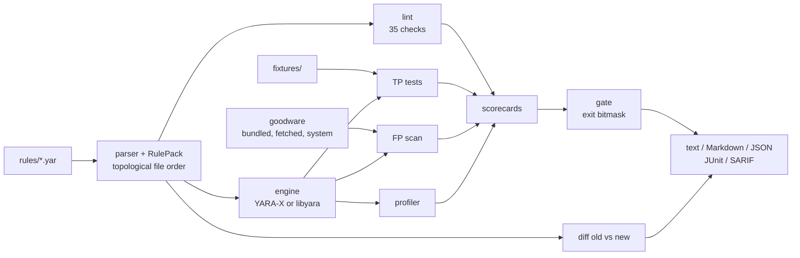

# yaraci

**A CI harness for YARA rule quality.** yaraci lints rules, proves each rule fires
on its own fixtures, scans goodware for false positives, profiles every rule's
scan cost, diffs two versions of a rule set by *what they match*, and turns all
of it into one exit code plus JUnit and SARIF reports.

[](https://github.com/SlateGitOrg/yaraci/actions/workflows/ci.yml)

```
$ yaraci check examples/pack-v2
...
GATE     FAIL (exit 31)
  - 4 lint finding(s) at or above 'error'
  - 2 fixture expectation(s) failed
  - 2 rule(s) without a match fixture
  - 3 goodware match(es) (max 0)
  - slow rule(s): SUSP_Generic_LongBase64Blob, test_rule
  - 3 rule(s) graded below C
```

## Why

Detection rules ship like code but are rarely tested like code. The failure modes
are quiet: a rule "simplified" in review starts alerting on a crypto library's
README; a string added under `all of them` means the rule never fires again; a
regex with no literal anchor makes the *whole* rule set scan about 100x slower
(v2 in the benchmark below adds one such regex). None of these are compile errors,
so a syntax-only check passes and the regression ships.

yaraci treats a rule pack the way a test runner treats a codebase, so detection
engineers and SOC teams who keep YARA rules in git can gate pull requests on
behaviour, not just syntax.

## Features

| Question | Stage | Evidence |
|---|---|---|
| Is it well-formed and triageable? | `lint` | 35 check codes: naming, metadata, string atoms, condition anti-patterns, engine diagnostics |
| Does it fire? | `test` | every public rule ships `fixtures/<Rule>/match/` (and optional `nomatch/` near-misses) |
| Does it stay quiet on benign software? | `fp` | bundled goodware, pinned SHA-256-verified PyPI wheels, opt-in system binaries |
| Is it cheap? | `profile` | per-rule scan time over a corpus, robust (median/MAD) slow-rule detection |
| What did this change do? | `diff` | structural diff + new false positives / lost true positives between two pack versions |
| Does it behave the same on both engines? | `parity` | libyara vs YARA-X match sets |

* **One verdict, every reason.** `yaraci check` runs all stages, grades each rule
  A–F, and returns a bitmask exit code so a single CI run reports every failing gate.
* **Two engines behind one protocol:** YARA-X (default) and classic libyara via
  `yara-python`.
* **Reports for every consumer:** terminal text, Markdown (job summaries and PR
  comments), JSON, JUnit XML and SARIF 2.1.0 for code scanning.
* **Reviewable exceptions:** in-source suppressions (`// yaraci:ignore YC301`) and an
  FP allowlist keyed by rule + SHA-256 that requires a reason and an expiry date.
* **Hostile-input safe corpus loading:** symlinks are never followed, archives are
  expanded one level deep in memory under byte and member budgets, and fetched
  goodware is SHA-256 pinned.
* **Strict config:** unknown or mistyped `yaraci.toml` keys are errors, so a typo
  cannot silently switch off a gate.

## Architecture



Everything runs over one immutable data structure, the **RulePack**: rule files
parsed by yaraci's own front-end and ordered by their cross-file rule references.
Static stages (lint) read the AST; scan stages (TP, FP, profile, diff, parity)
compile the same sources with the real engine, which stays the authority on
validity. Each stage produces a typed report, `quality.py` folds them into a
per-rule scorecard, and `gate.py` turns the scorecards into the exit code that
the renderers report.

Module map, algorithms and complexity: [docs/ARCHITECTURE.md](docs/ARCHITECTURE.md).
The scoring model: [docs/QUALITY_MODEL.md](docs/QUALITY_MODEL.md).
Every check: [docs/CHECKS.md](docs/CHECKS.md). Threats: [docs/THREAT_MODEL.md](docs/THREAT_MODEL.md).

## Quick start

Prerequisites: [uv](https://docs.astral.sh/uv/) 0.7 or newer, `make`, and
Python 3.12 (uv installs it). CI runs on macOS and Ubuntu; no network access is
needed after `uv sync` except for the optional `make goodware`.

```bash
git clone https://github.com/SlateGitOrg/yaraci.git
cd yaraci
uv python install 3.12
uv sync --frozen                         # yara-x, yara-python and the dev tools

uv run yaraci check examples/pack-v1     # gate the clean example pack (exit 0)
make check                               # ruff format + lint, mypy --strict, 259 tests, coverage >= 80%
make demo                                # offline end-to-end run on both example packs (writes out/)
make goodware                            # optional: fetch 7 pinned PyPI wheels as extra goodware
```

If `make goodware` fails with `CERTIFICATE_VERIFY_FAILED` on macOS, the Python in
use is a python.org build without its CA bundle installed: run its
`Install Certificates.command`, or prefix the command with
`SSL_CERT_FILE=/etc/ssl/cert.pem`.

## Usage

```bash
uv run yaraci check examples/pack-v1 --junit out/junit.xml --sarif out/results.sarif --markdown out/summary.md
uv run yaraci diff examples/pack-v1 examples/pack-v2 --output out/diff.md
uv run yaraci explain YC403
```

Each stage is also its own subcommand (`lint`, `test`, `fp`, `profile`, `parity`);
`yaraci <command> --help` lists the options.

### Example run

`make demo` checks a clean pack (v1), a deliberately regressed revision (v2),
diffs them and runs engine parity. Excerpt from a run in a fresh clone (no fetched
goodware; `...` marks elided lines; timings vary by machine):

```
$ yaraci check examples/pack-v1 --repeat 3 --junit out/v1/junit.xml --sarif out/v1/results.sarif ...
yaraci check lab-pack: 10 rule(s) in 4 file(s), engine yara-x 1.22.0
LINT     0 error, 0 warning, 0 info
COMPILE  ok
TP       17 fixture(s): 17 passed, 0 failed; untested: none
FP       19 goodware sample(s) (1.45 MiB; bundled 19; 0 archive member(s)): 0 match(es), 0 allowlisted
PROFILE  isolated, 36 sample(s) / 1.45 MiB x3 on yara-x 1.22.0
  full pack: 633 us/MiB above baseline (1,277 MiB/s overall); median rule: 2.6 us/MiB
  ...
GATE     PASS (exit 0)

$ yaraci check examples/pack-v2 ...
LINT     4 error, 6 warning, 4 info
  warning YC301 rules/generic.yar:9 [SUSP_Generic_LongBase64Blob] $b64 has weak atom [none] (quality 0 < 45)
  warning YC502 rules/generic.yar:9 [SUSP_Generic_LongBase64Blob] [slow_pattern] slow pattern: this pattern may slow down the scan
  error   YC201 rules/generic.yar:14 [test_rule] missing required meta key 'author'
  error   YC403 rules/generic.yar:18 [test_rule] filesize must be >= 2097153 and <= 1048575: unsatisfiable
  warning YC301 rules/scripts.yar:66 [SUSP_SH_PipeToShell] $pipe has weak atom [73 68] (quality 36 < 45)
  ...
TP       16 fixture(s): 14 passed, 2 failed; untested: SUSP_Generic_LongBase64Blob, test_rule
  FAIL MAL_RansomNote_Generic/nomatch/wallet-lib-README.txt: expected to not match
  FAIL PUA_PE_Packer_UPX/match/packed.exe.bin: expected to match
FP       19 goodware sample(s) (1.45 MiB; bundled 19; 0 archive member(s)): 3 match(es), 0 allowlisted
  FP   MAL_RansomNote_Generic <- goodware/docs/crypto-wallet-guide.md [bundled] ($cue1, $cue2, $cue3, $cue4)
  FP   SUSP_SH_PipeToShell <- goodware/scripts/install-tool.sh [bundled] ($pipe)
  FP   SUSP_Generic_LongBase64Blob <- goodware/src/app_icon.py [bundled] ($b64)
PROFILE  isolated, 35 sample(s) / 1.45 MiB x3 on yara-x 1.22.0
  full pack: 27,923 us/MiB above baseline (36 MiB/s overall); median rule: 5.5 us/MiB
  rule                                       us/MiB  x median  slowest sample
  SUSP_Generic_LongBase64Blob              22,937.6    4150.8  goodware/src/app_icon.py  SLOW
  test_rule                                   411.7      74.5  goodware/blobs/log-text.txt  SLOW
  ...
SCORECARD
  F  15  test_rule  -40 lint ({'warning': 3, 'error': 4, 'info': 3}); -25 no match fixture; -20 slow: 74.5x pack median (robust z=64.1)
  F  24  SUSP_Generic_LongBase64Blob  -11 lint ({'info': 1, 'warning': 2}); -25 no match fixture; -20 1 goodware match(es); -20 slow: 4150.8x pack median (robust z=3617.0)
  D  40  MAL_RansomNote_Generic  -40 1 failing fixture(s); -20 1 goodware match(es)
  C  60  PUA_PE_Packer_UPX  -40 1 failing fixture(s)
  B  75  SUSP_SH_PipeToShell  -5 lint ({'warning': 1}); -20 1 goodware match(es)
  ...
GATE     FAIL (exit 31)

$ yaraci diff examples/pack-v1 examples/pack-v2 --output out/diff.md
yaraci diff: 3 added, 1 removed, 1 renamed, 2 modified, 6 unchanged
  modified  PUA_PE_Packer_UPX
      string added $ver = /UPX [0-9]\.[0-9]{2}/
      string removed $s1 = "UPX1"
  renamed   MAL_ELF_CoinMiner_Stratum -> MAL_ELF_Miner_Stratum
  modified  MAL_RansomNote_Generic
      condition: filesize < 65536 and any of ($claim*) and 2 of ($cue*) -> filesize < 65536 and 3 of them
  ...
impact (matches old -> new; only rules whose matches changed):
  PUA_PE_Packer_UPX: 1 -> 0
      LOST TP: fixtures/PUA_PE_Packer_UPX/match/packed.exe.bin
  MAL_RansomNote_Generic: 1 -> 3
      NEW FP: goodware/docs/crypto-wallet-guide.md
      NEW FP: fixtures/MAL_RansomNote_Generic/nomatch/wallet-lib-README.txt
  ...
verdict: 4 new FP, 1 lost TP, 1 fixture(s) uncovered by removed rules
[exit 6]

$ yaraci parity examples/pack-v1
yaraci parity: libyara vs yara-x over 36 sample(s)
verdict: consistent

artifacts written to out/:
  v1: junit.xml 44 tests / 0 failures; results.sarif 0 results; report.json; summary.md
  v2: junit.xml 51 tests / 10 failures; results.sarif 26 results; report.json; summary.md
```

The example rules detect *synthetic, benign* lab artifacts (header stubs and
harmless scripts generated by `scripts/make_examples.py`); see [DATA.md](DATA.md).

### Pack layout and policy

```
my-pack/
  yaraci.toml                 # policy (all keys optional)
  rules/*.yar                 # compiled together, ordered by rule dependencies
  fixtures/<RuleName>/match/  # every file MUST match RuleName
  fixtures/<RuleName>/nomatch/# no file may match RuleName
  fp-allowlist.toml           # accepted FPs: rule + sha256 + reason + expiry
```

```toml
[pack]
engine = "yara-x"            # or "libyara"
[lint]
name_prefixes = ["MAL", "SUSP", "PUA", "HKTL", "INFO"]
required_meta = ["author", "description", "date"]
[goodware]
dirs = ["../goodware"]
[gate]
lint_fail_on = "error"
max_fp = 0
fail_on_slow = true
min_grade = "C"
```

[`examples/pack-v1/yaraci.toml`](examples/pack-v1/yaraci.toml) is a complete,
working policy. Suppress a finding in source with `// yaraci:ignore YC301` or
`meta: yaraci_ignore = "YC301"`; the other suppression scopes are listed in
[docs/CHECKS.md](docs/CHECKS.md).

### Exit codes

| Code | Meaning |
|---|---|
| 0 | every gate passed |
| 1 / 2 / 4 / 8 / 16 | lint / true-positive / false-positive / performance / quality gate failed (OR-ed together) |
| 32 | the rule set does not compile (scan stages skipped) |
| 64 / 70 | usage or configuration error / internal error (not bitmasks) |

`yaraci diff` uses 4 for new false positives and 2 for lost true positives.

### In a rules repository's CI

```yaml
jobs:
  yara-rules:
    runs-on: ubuntu-latest
    permissions:
      contents: read
      security-events: write   # SARIF upload to code scanning
      actions: read            # upload-sarif reads the workflow run
    steps:
      - uses: actions/checkout@v4
      - uses: astral-sh/setup-uv@v6
      - run: uv run yaraci check rules-pack --junit out/junit.xml --sarif out/results.sarif --markdown out/summary.md
      - run: cat out/summary.md >> "$GITHUB_STEP_SUMMARY"
        if: always()
      - uses: github/codeql-action/upload-sarif@v4
        if: always()
        with: { sarif_file: out/results.sarif, category: yaraci }
      - run: uv run yaraci diff base-pack rules-pack --output out/diff.md   # on pull requests
```

This repository dogfoods the same setup: [`.github/workflows/ci.yml`](.github/workflows/ci.yml)
runs `make check` and `make demo` on Ubuntu and macOS, then gates
`examples/pack-v1` against the fetched goodware, writes JUnit and a Markdown job
summary, and uploads SARIF to code scanning. Code scanning accepts uploads on
public repositories (private ones need GitHub Code Security), so the upload step is
skipped on private copies and fork pull requests; the SARIF file is still kept as a
build artifact.

## How it works

* **Parsing.** A context-sensitive lexer (hex strings after `=`, regexes after `=` or
  `matches`) feeds a precedence-climbing parser for the full condition grammar. A
  canonical printer satisfies `unparse(parse(unparse(e))) == unparse(e)`,
  property-tested with Hypothesis; diffs and messages use it.
* **Dependency order.** Files are ordered with Kahn's algorithm over cross-file rule
  references (path as tie-break); a rule's isolated source is its reference closure
  plus every `global` rule.
* **Atom quality.** Fixed byte runs are extracted from text, hex and regex strings
  (quantifier-aware) and every 4-byte window is scored with a heuristic modelled on
  libyara's; the weakest alternative bounds the string.
* **Condition analyses.** Unconstrained conditions, `N of (set)` larger than its set,
  and contradictory `filesize` intervals (checked against brute force in property
  tests) are proven statically.
* **Profiling.** Each rule is compiled in isolation and timed as min-of-k per sample
  minus a strong-atom baseline; slow means over budget, or ≥ 4x the pack median with
  robust z ≥ 3.5 (median/MAD) above a 200 us/MiB noise floor. `--method leave-one-out`
  measures interaction effects instead.
* **Diffing.** Rules reduce to a logic key and a meta key (modified / metadata /
  cosmetic / unchanged; renames pair equal logic keys), then both versions scan the
  union corpus once and every per-rule flip is classified as new/fixed FP or
  lost/gained TP.

Design decisions with their trade-offs are recorded in [DECISIONS.md](DECISIONS.md).
The load-bearing ones:

* **Own parser, engine as authority.** Neither binding exposes rule structure, so
  yaraci parses YARA itself for static analysis, but validity is always decided
  by the real engine (YC501), and unparseable files are still compiled and scanned.
* **Fixtures by convention, scanned with the whole pack.** Tests exercise rules as
  deployed (helper and global rules included).
* **Isolation profiling with a strong-atom baseline, minimum of k repeats, median/MAD
  outliers.** Cheap, explainable, robust to one pathological rule; leave-one-out is
  available for interaction effects.
* **Behaviour outranks style in scoring.** One false positive costs more than a
  rule can lose to lint.
* **Bitmask exit codes.** One CI run reports every failing gate.

## Benchmarks and evaluation

All numbers below come from committed commands; rerun them to reproduce.

**Profiling benchmark:** `make bench` writes [bench/RESULTS.md](bench/RESULTS.md)
and `bench/results.json` from a seeded, in-memory 9 MiB synthetic corpus. Highlights
from the committed run (Apple-silicon laptop shared with other jobs):

| Measurement | YARA-X 1.22.0 | libyara 4.5.4 |
|---|---:|---:|
| v1 pack throughput | 1,401.7 MiB/s | 294.0 MiB/s |
| v2 pack throughput (one regex with no literal atom added) | 13.0 MiB/s | 9.4 MiB/s |
| `SUSP_Generic_LongBase64Blob` cost (isolated) | 77,089 us/MiB | 104,216 us/MiB |
| PowerShell rule before / after anchoring its regexes | 709.2 / 144.4 us/MiB | 1,431.2 / 1,459.0 us/MiB |
| v1 rules flagged slow in any of 3 runs | none | 2 (`MAL_Doc_OLE_AutoOpenShell`, `MAL_RansomNote_Generic`) |

The PowerShell row came out of developing the example pack: the profiler flagged
the original v1 rule, anchoring its regexes on a leading `\s` made it ~4.9x
cheaper on YARA-X, and the same edit made no difference on libyara. The last row
is why slow-rule verdicts are per engine (see Limitations).

**False positives on real goodware:** after `make goodware`, on a macOS machine:

```
$ uv run yaraci fp examples/pack-v1 --system
FP       310 goodware sample(s) (58.48 MiB; bundled 19, fetched 135, system 156; 134 archive member(s)): 0 match(es), 0 allowlisted
$ uv run yaraci fp examples/pack-v2 --system
FP       310 goodware sample(s) (58.48 MiB; bundled 19, fetched 135, system 156; 134 archive member(s)): 6 match(es), 0 allowlisted
  FP   SUSP_Generic_LongBase64Blob <- /bin/ksh [system] ($b64)
  FP   SUSP_Generic_LongBase64Blob <- /usr/bin/afscexpand [system] ($b64)
  FP   SUSP_Generic_LongBase64Blob <- /usr/bin/assetutil [system] ($b64)
  ... (plus the 3 bundled-goodware FPs shown in the example run)
```

The system-binary set depends on the machine, so these counts are not portable;
the bundled and fetched sources are. Without `--system`, the v1 pack matches
nothing in the 154 bundled + fetched samples, which is what the CI gate job checks.

**Engine parity:** `uv run yaraci parity examples/pack-v2 --corpus examples/goodware --corpus .cache/goodware --corpus examples/pack-v2/fixtures`
reports consistent results over 170 samples.

## Testing

```bash
make test                        # pytest with branch coverage, fails under 80%
uv run --frozen pytest tests/test_lint.py -q    # one module
make check                       # everything CI's check job runs
```

`make test` runs 259 tests at 97 % line + branch coverage of `src/yaraci`:

* **Front-end:** lexer, parser, hex strings and unparse round-trips, plus
  Hypothesis property tests (`test_syntax.py`, `test_properties.py`).
* **Analyses:** every lint check fires on a bad rule and stays quiet on a good one;
  atom-quality heuristics; pack discovery, dependency order and isolation.
* **Stages:** TP fixtures, goodware FP and the allowlist, profiling statistics,
  scoring and the gate; both engine backends through the same protocol.
* **Corpus safety:** dedup, symlinks, one-level archive expansion and zip-of-zips
  budgets; verified goodware fetching against `file://` manifests.
* **End to end:** golden results on the example packs, every CLI command and exit
  code, and all five report formats.

`make check` also verifies that the example fixtures match `scripts/make_examples.py`
byte for byte and that `docs/CHECKS.md` matches the check registry.

## Project layout

```
src/yaraci/
  syntax/        lexer, parser, AST, hex strings, canonical printer
  lint/          check registry, 4 check families, atom-quality estimator
  engine/        Backend protocol, YARA-X and libyara adapters
  report/        text, Markdown, JSON, JUnit and SARIF renderers
  pack.py        RulePack discovery, topological order, isolation
  corpus.py      bounded, archive-aware corpus builder
  goodware.py    pinned manifest, verified fetch, FP allowlist
  testing.py, fp.py, profiling.py, quality.py, gate.py, diff.py, parity.py
  pipeline.py, cli.py
tests/           unit, property, golden and CLI tests
examples/        pack-v1 (clean), pack-v2 (regressed), bundled goodware
goodware/        oss-manifest.toml (pinned PyPI wheels)
scripts/         demo, benchmark, fixture and check-doc generators
bench/           committed benchmark results
docs/            architecture, checks, quality model, threat model
```

## Limitations

* **Synthetic evaluation data.** Example rules, fixtures, bundled goodware and the
  benchmark corpus are all generated for this project. They demonstrate the
  mechanics; they say nothing about detection rates on real malware, and the
  bundled goodware (19 files) is far too small to establish real FP rates. Real
  FP evidence needs `make goodware`, `--system` and, in practice, a much larger
  curated goodware set than the 7 pinned wheels.
* **Timing is noisy and engine specific.** Profiles were taken on a laptop shared
  with other builds. Min-of-k and a noise floor reduce flakiness but do not remove
  it; small costs (< 200 us/MiB) are not meaningful. libyara and YARA-X rank rules
  differently (see the benchmark), and only the configured engine gates.
* **Isolation hides interactions.** The v1 pack costs 633 us/MiB above baseline
  as a whole in the example run above, while no single isolated rule costs more
  than ~5 us/MiB:
  atoms and automaton effects only appear together. `--method leave-one-out`
  measures interactions but is noisy when one rule dominates the pack.
* **Static atom quality is an estimate.** It is modelled on libyara's heuristic,
  does not replicate either engine's atom selection, and the regex literal
  extractor ignores alternation inside groups (weakest-branch analysis is only
  done at the top level).
* **Parser coverage.** The front-end handles the YARA 4.x / YARA-X surface used
  in typical packs (including `with`, `for..of`, `for..in`, rule sets, string
  modifiers with arguments) but not `include`, external variables declared via
  the CLI, or YARA-X-only syntax added after 1.22.
* **Scoring weights are heuristics** chosen by hand, not fitted to outcome data.
* **Fixture convention is per rule.** A sample that should match several rules
  must be duplicated into each rule's directory.

## Roadmap

* Grouped-alternation atom analysis and a calibration study of the atom heuristic
  against YARA-X's own atom selection.
* Fixture manifests (one sample, many expected rules) alongside the directory convention.
* Per-rule profiling against large real goodware sets with sampling, and a
  persistent baseline so the profiler can gate on *regressions* in cost.
* A YARA-X module-output-aware lint family (e.g. PE fields used on non-PE fixtures).
* Rule-coverage reporting per MITRE ATT&CK technique from `reference` metadata.

## License

MIT — see [LICENSE](LICENSE).
